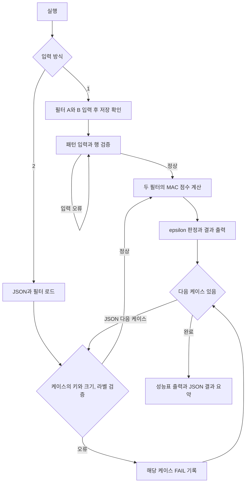

# Mini NPU Simulator

Python 반복문으로 그림과 필터의 같은 위치를 곱하고 더하는 콘솔 프로그램입니다.
입학연수 개발 입문 과제, 학습시간 40시간에 해당합니다.

**제출용 프로젝트 URL:** https://github.com/sopa3344/mini-npu-simulator

`main` 브랜치의 `main.py`와 이 README가 필수 제출 파일입니다. 예제 데이터와 검증 코드도 함께 제공합니다.

**구현과 자체 검증을 완료했습니다. 교육기관 원본 `data.json`은 제공되지 않아 원본 데이터의 결과는 아직 확인하지 못했습니다.**
`data.sample.json`과 `data.errors.json`은 이번에 직접 만든 학습용 파일입니다. 원본과 혼동하지 않도록 `data.json`이라는 이름의 대체 파일을 만들지 않았습니다.

## 실행 방법

Python 3.8 이상이면 외부 패키지 설치 없이 실행할 수 있습니다.
이 폴더에서 터미널을 연 뒤 실행합니다. Windows에서는 환경에 따라 `python` 대신 `py`, Ubuntu에서는 `python3`를 사용합니다.

```bash
python main.py
```

- `1`: 3×3 필터 A, 필터 B, 패턴을 각각 세 줄 입력합니다.
- `2`: `main.py`와 같은 폴더에 있는 원본 `data.json`을 분석합니다.
- 원본 파일이 없으면 안내 문구를 출력하고 종료합니다. 예제로 조용히 대체하지 않습니다.

지금 포함된 학습용 데이터를 실행하려면 다음 명령을 사용합니다.

```bash
python main.py --mode json --data data.sample.json
```

다른 위치의 원본 파일도 지정할 수 있습니다. 명시한 상대 경로는 현재 터미널 폴더를 기준으로 해석합니다.

```bash
python main.py --mode json --data "C:/Downloads/data.json"
```

### 3×3 재현 예시

먼저 필터 A를 세 줄 입력합니다.

```text
0 1 0
1 1 1
0 1 0
```

그다음 필터 B를 세 줄 입력합니다.

```text
1 0 1
0 1 0
1 0 1
```

저장한 두 필터가 화면에 표시됩니다. 패턴에도 위의 X를 입력하면 A 점수는 `1.0`, B 점수는 `5.0`, 판정은 `B`입니다.
패턴에 십자가를 입력하면 A 점수 `5.0`, B 점수 `1.0`, 판정은 `A`입니다. 시간은 실행할 때마다 달라집니다.
행에 숫자가 부족하거나 많거나, `abc` 같은 문자가 들어가면 해당 행만 다시 입력받습니다.
각 행을 하나씩 받아 정확히 세 행이 모일 때까지 기다립니다. 입력 종료 또는 Ctrl+C는 안내 후 종료합니다.

### 추가 명령

```bash
# 최소 10회, 기본 1,000회. 1D/2D 비교도 함께 출력
python main.py --mode json --data data.sample.json --repeats 1000 --compare-flat

# 오류를 넣은 별도 데이터 분석
python main.py --mode json --data data.errors.json

# 검증용 테스트
python -m unittest -v

# N을 지정해 패턴 데이터 생성. 기존 파일은 덮어쓰지 않음
python main.py --generate-sample my-patterns.json --sizes 3 5 7 13 25
```

패턴 생성기는 중심선이 하나로 정해지는 3 이상의 홀수 N을 받습니다. MAC과 데이터 검증 함수는 양의 정사각형 크기에 일반적으로 적용할 수 있습니다.
모드 2는 필수 필터인 5, 13, 25가 빠지면 별도 설정 오류로 알립니다. 그래서 생성 시에도 기본 크기를 포함하는 것이 좋습니다.

종료 코드 `0`은 정상 완료, `1`은 케이스 FAIL 또는 필터 설정 오류, `2`는 파일/전체 스키마/인수 오류, `130`은 입력 중단입니다.
예제의 종료 코드 `1`은 의도한 동점 FAIL을 보고한 결과이며 프로그램 비정상 종료가 아닙니다.

## 파일 안내

| 파일 | 역할 |
| --- | --- |
| `main.py` | 필수 제출용 프로그램. 이 파일만으로 실행 가능 |
| `README.md` | 실행 방법, 구현 설명, 결과 리포트 |
| `data.sample.json` | 직접 생성한 8개 학습 케이스, 정상 패턴 6개와 동점 2개 |
| `data.errors.json` | 정상 1개와 의도적 데이터/라벨 오류 5개 |
| `test_main.py` | 표준 라이브러리 unittest 기반 검증 28개 |

## 구현 요약

### 전체 실행 흐름



직접 입력 모드에는 expected가 없으므로 PASS/FAIL을 계산하지 않습니다. JSON의 구조 전체를 읽을 수 없는 경우에는 테스트 미실행으로 종료합니다.

### 자료 구조와 MAC

2차원 리스트에 숫자를 저장합니다. `matrix[행][열]`로 읽고 바꿀 수 있습니다. 인덱스는 0부터 시작합니다.
입력 행렬은 계산 전에 크기와 숫자 유형을 검사하고 float로 변환합니다. `true`, `false`, 숫자 문자열, NaN, 무한대는 JSON 행렬 값으로 허용하지 않습니다.
검증은 성능 측정 바깥에서 수행합니다. `mac()`에는 검증한 동일 크기의 행렬을 전달합니다.

```python
total = 0.0
for row in range(size):
    for col in range(size):
        total += pattern[row][col] * kernel[row][col]
```

여기서 한 칸을 곱하고 누적하는 작업이 MAC 1회입니다. 이진 패턴에서는 두 값이 모두 1인 칸이 점수에 더해집니다.
0끼리 일치하는 칸에는 가산점이 없습니다. 따라서 이 점수는 모든 종류의 그림에 통용되는 정규화된 유사도나 정확도가 아닙니다.
학습, 필터 이동, 실제 NPU 병렬 처리는 구현하지 않습니다. CPU에서 MAC 원리를 재현하는 프로그램입니다.

### JSON 구조와 라벨 정규화

실제 배열 전체는 `data.sample.json`에서 확인할 수 있습니다.

| 경로/키 | 규칙 |
| --- | --- |
| `filters.size_5` | 5×5 Cross와 X 필터 객체 |
| `filters.size_13` | 13×13 Cross와 X 필터 객체 |
| `filters.size_25` | 25×25 Cross와 X 필터 객체 |
| `patterns.size_13_2.input` | 키에서 N=13을 추출해 `filters.size_13` 선택 |
| `patterns.size_13_2.expected` | 문자열 정규화 후 판정 결과와 비교 |

| 외부 표기 | 내부 표준 라벨 |
| --- | --- |
| `+`, `cross`, `Cross` | `Cross` |
| `x`, `X` | `X` |

앞뒤 공백과 대소문자도 정리합니다. 알 수 없는 라벨을 억지로 X로 바꾸지 않습니다.
`cross`와 `+`처럼 정규화 후 같은 라벨이 두 번 등장하면 어떤 필터가 맞는지 모호하므로 해당 묶음을 오류로 처리합니다.
`UNDECIDED`는 세 번째 패턴 종류가 아니라 동점 판정 상태입니다. expected의 허용 라벨은 Cross/X 두 가지입니다.

### 동점 비교 정책

`abs(score_a - score_b) < 1e-9`이면 `UNDECIDED`입니다. 차이가 정확히 `1e-9`이면 동점이 아닙니다.
`0.1 + 0.2`와 `0.3`처럼 이진 부동소수점으로 다르게 표현되는 값에 대해 아주 작은 차이를 승패로 해석하지 않기 위한 정책입니다.
표시용 반올림 결과로 비교하지 않습니다. 계산된 원래 float 점수로 비교합니다.
고정 절대 허용오차는 이번 과제의 명시적 선택입니다. 입력 크기나 점수의 규모가 크게 달라지면 상대 허용오차를 포함한 정책을 별도로 검토해야 합니다.
입력 자체는 유한수여도 곱셈과 누적 중 무한대가 될 수 있어 최종 점수도 검사합니다.

## 결과 리포트

검증 날짜는 한국 시간 2026-11-09입니다. 아래 수치는 직접 만든 예제의 실제 실행 결과입니다.

| 검증 대상 | 결과 | 재현 방법 |
| --- | --- | --- |
| Python 3.12.14 자동 검증 | 28개 통과 | `python -m unittest -v` |
| Python 3.15.2 자동 검증 | 28개 통과 | `python -m unittest -v` |
| 정상과 동점 혼합 예제 | 총 8개, PASS 6개, FAIL 2개 | `--mode json --data data.sample.json` |
| 오류 재현 예제 | 총 6개, PASS 1개, FAIL 5개 | `--mode json --data data.errors.json` |
| 직접 입력 X / Cross | B / A 판정 확인 | 위의 3×3 재현 예시 |
| 잘못된 행 입력 | 같은 행 재입력 후 정상 완료 | `--mode manual`에서 한 행에 숫자 2개 입력 |
| 직접 입력 동점 | 판정 불가 표시 | 필터 두 개와 패턴의 모든 칸에 0 입력 |
| 교육기관 원본 데이터 | 미확인 | 원본 파일 미제공 |

Python 3.8 문법 파싱도 통과했습니다. Python 3.8 인터프리터에서 직접 실행한 결과는 아닙니다.
자동 검증의 28개 통과와 데이터 판정의 PASS/FAIL은 서로 다른 지표입니다. 의도한 FAIL을 정확히 보고하면 해당 검증은 통과합니다.

### 실패 원인과 해석

1. `data.sample.json`의 정상 Cross/X 6개는 모두 PASS입니다.
2. expected의 `+`와 필터의 `cross`를 모두 `Cross`로 바꿔 표기 차이로 생기는 실패를 막았습니다.
3. expected와 필터의 `x`는 `X`가 되어 같은 기준으로 비교됩니다.
4. `size_5_3`은 모든 입력이 0이므로 두 점수가 모두 0입니다.
5. 이 케이스의 expected는 Cross지만 동점 규칙에 따라 UNDECIDED이므로 FAIL입니다.
6. `size_13_3`의 Cross 점수는 `0.30000000000000004`, X 점수는 `0.3`입니다.
7. 두 점수의 차이 약 `5.55e-17`은 `1e-9`보다 작으므로 UNDECIDED로 판정합니다.
8. expected가 X라고 해서 X를 강제로 선택하거나 epsilon을 바꾸지 않았습니다. 이 FAIL은 비교 정책을 적용한 정상 결과입니다.
9. 오류 예제의 `size_5_9`는 키의 크기 5와 실제 1×1 입력이 달라 데이터/스키마 FAIL입니다.
10. `size_13_9`의 triangle 라벨과 `bad_key`의 키 형식은 표준 라벨 및 키 규칙을 벗어납니다.
11. `size_7_1`은 7×7 입력에 대응하는 필터가 없어서 FAIL입니다.
12. `size_25_9`는 Cross 입력에 expected=X를 의도적으로 적어 판정 불일치를 재현했습니다.
13. 실제 원본에서 판정 불일치가 발생하면 라벨이 틀렸다고 바로 단정하지 않고 데이터와 필터, MAC 계산을 함께 확인해야 합니다.
14. 로직 문제는 3×3의 손계산 점수 5와 1, 음수/실수 예제, 1D/2D 동일 결과 검증으로 따로 확인했습니다.
15. 스키마 오류가 있는 케이스만 실패로 기록하며, 뒤의 정상 케이스는 계속 분석합니다.
16. 필터 오류는 영향을 받는 케이스에서 FAIL로 나타나고, 사용되지 않는 필터의 오류도 별도 설정 오류로 출력합니다.
17. 파일을 읽을 수 없거나 최상위 patterns가 잘못되면 총 0개 성공으로 포장하지 않고 테스트 미실행으로 표시합니다.
18. 개발 중 Windows 임시 폴더의 접근 제한으로 파일 테스트 4개가 실패했습니다. 임시 테스트 파일을 프로젝트 내부에 만들도록 바꾼 뒤 두 Python 버전에서 모두 통과했습니다.
19. 원본 `data.json`의 실제 FAIL 목록과 최종 통과율은 원본 분석 뒤 이 리포트에 별도로 추가해야 합니다.

### 실제 성능 측정

Windows 11, Python 3.12.14, 워밍업 5회 뒤 크기마다 1,000회 측정한 필터 1개의 호출 평균입니다.
`perf_counter_ns()`로 측정하고 나노초를 1,000,000으로 나눠 ms로 바꿉니다. 입력, 파일 읽기, 출력, 배열 생성과 검증은 제외했습니다.
함수 호출과 시계 호출 사이의 작은 비용은 포함되며 OS 스케줄링 등의 영향을 받습니다.

| 크기 | 평균 시간(ms) | MAC 횟수 N² |
| --- | ---: | ---: |
| 3×3 | 0.000663 | 9 |
| 5×5 | 0.001349 | 25 |
| 13×13 | 0.008679 | 169 |
| 25×25 | 0.028374 | 625 |

1. 바깥 반복문은 N회, 안쪽 반복문도 N회 실행되므로 한 필터당 N² MAC을 수행합니다.
2. N²는 MAC 횟수입니다. 곱셈과 덧셈을 별개의 산술 연산으로 세면 각각 N²회, 합계 2N²회입니다.
3. Cross와 X 두 필터의 점수를 모두 계산하면 2N² MAC이며 시간 복잡도는 여전히 O(N²)입니다.
4. 3×3에서 25×25로 커질 때 칸 수는 9에서 625로 약 69.44배 늘어납니다.
5. 이번 측정 시간은 약 42.80배 늘었습니다. 작은 입력의 고정 비용과 측정 잡음 때문에 칸 수 비율과 정확히 같을 필요는 없습니다.
6. 측정값은 크기에 따라 연산 시간이 증가한 사례입니다. O(N²)의 근거는 이중 반복문의 정확한 실행 횟수입니다.
7. N이 두 배일 때 약 네 배의 칸을 처리하는 제곱 증가이며, 지수 증가와는 다릅니다.
8. 입력과 필터를 저장하는 공간은 O(N²), MAC 자체의 추가 누적 변수는 O(1) 공간입니다.
9. 같은 크기 패턴 P개를 두 필터로 분석하면 계산량은 O(PN²)입니다.
10. 이 시간은 Python의 CPU 실행 시간입니다. 실제 NPU 장치의 성능이나 병렬 처리 속도로 해석하면 안 됩니다.

### 보너스 1D 비교

| 크기 | 2D(ms) | 1D(ms) | 2D/1D |
| --- | ---: | ---: | ---: |
| 3×3 | 0.000663 | 0.000576 | 1.15 |
| 5×5 | 0.001349 | 0.000929 | 1.45 |
| 13×13 | 0.008679 | 0.005052 | 1.72 |
| 25×25 | 0.028374 | 0.019833 | 1.43 |

동일 입력과 반복 횟수로 측정했고, 같은 행 우선 순서로 곱하고 더하므로 두 방식의 점수도 같습니다.
위 측정에서는 1D가 더 빨랐습니다. 다만 배열 변환 비용을 제외한 값이고 실행 순서와 PC 상태의 영향을 받아 항상 빨라진다고 보장하지 않습니다.
평탄화에도 O(N²) 시간과 추가 공간이 필요합니다. 한 번만 계산할 경우 변환 비용까지 포함하면 이득이 줄거나 사라질 수 있습니다.
Python 리스트는 숫자 원소가 모두 연속 배치된 수치 배열과 다릅니다. 여기서는 중첩 인덱스 접근과 반복 구조를 단순화한 효과를 관찰했습니다.

## 제출 전 확인

- [x] main.py와 README 작성, 외부 패키지 미사용
- [x] 직접 입력, 재입력, JSON 검증과 케이스별 실패 처리
- [x] 라벨 정규화, epsilon 정책, 실제 성능표와 결과 합계
- [x] 실패 원인 분석과 O(N²) 분석
- [x] 선택 항목인 패턴 생성기와 1D 비교
- [ ] 교육기관 원본 data.json으로 재실행하고 원본 결과 추가
- [ ] 사용자가 코드 흐름과 실패 원인을 자기 말로 설명
- [ ] 교육기관 제출 완료 여부 확인

코드 작성과 위 실행 검증은 작업을 대신 진행한 결과입니다. 사용자의 40시간 수강 완료나 독립 구현을 뜻하지 않습니다.

## 공식 참고 자료

- [Python 부동소수점 설명](https://docs.python.org/3/tutorial/floatingpoint.html)
- [Python 고해상도 시간 측정](https://docs.python.org/3/library/time.html#time.perf_counter_ns)
- [Python JSON 읽기](https://docs.python.org/3/library/json.html#json.load)
- [Python unittest](https://docs.python.org/3/library/unittest.html)

코드 공부는 `mac`, `normalize_label`, `decide`, `validate_matrix`, `analyze_case`, `benchmark` 순서로 진행하면 됩니다.
